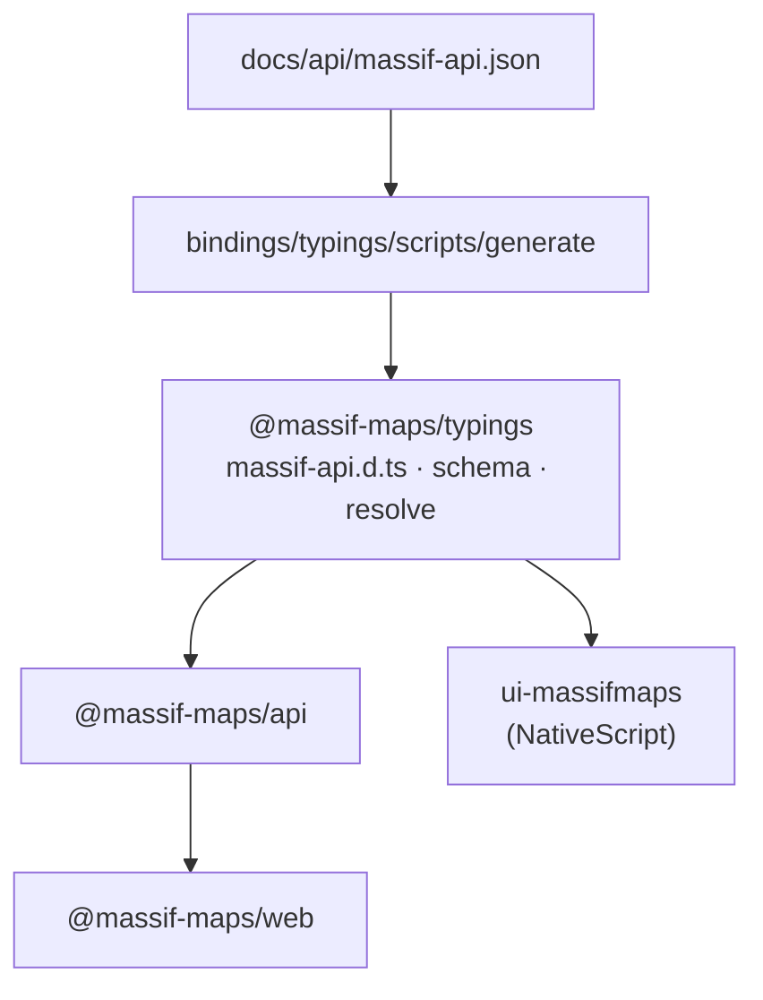

# `@massif-maps/typings`

## Problem

`docs/api/massif-api.json` is turned into TypeScript by a generator that exists **twice**
(`bindings/js/scripts/api-typings`, `integrations/nativescript/scripts/api-typings`). Each copy
writes `massif-api.d.ts` (types) and `schema.ts` (runtime tables: property codes, enum names, spec
classes, events), and each consumer commits its own result. Measured on master: the plugin's copy
already lacks `SunExposureOptions`, `computeSunExposure` and the `Record<string, number>` bag types
the SDK side has. A property added to the SDK (`TileLayer.farTileLOD`, PR #494) is invisible to the
plugin's typings, and its enum names are missing from `schema.ts`, so `resolve.ts` cannot translate
`FAR_TILE_LOD_DISTANCE` and the write falls through to `writeByType` as a bare `setInt`.

## Target

An app that uses a newer SDK, where the SDK only added or changed properties, bumps
`@massif-maps/typings` in its own `package.json`. No plugin release, no plugin code change.

## Decisions

### 1. Contents: types + tables + `resolve`

`schema.ts` is runtime data and `resolve.ts` is the only code that reads it (pure: no native call,
no `@nativescript/core`). Both ship, so the package is a normal `dependency` and is not erased at
build time. The surface:

- `massif-api.d.ts`: class names, property paths, specs, methods, events (types only);
- `schema`: `PROPS`, `ENUMS`, `SPEC_CLASS`, `EVENTS`, `METHODS`, `BASES`, `ALIASES`, `KIND_OF_CLASS`,
  `CLASS_NAMES`;
- `resolve`: `resolvePath`, `enumName`, `enumValue`, `findEvent`, `propertyNames`, ... (moved from
  `bindings/js/src/resolve.ts`, which the plugin's `resolve.ts` already duplicates line for line
  apart from comments).

`@massif-maps/api` stays a separate package and becomes a consumer: it keeps `index.ts`,
`bridge.ts`, `observable.ts` (the code that talks to a `NativeBridge`) and re-exports the types
(`export type * from '@massif-maps/typings'`), so an app's existing imports keep resolving.
Merging them was rejected: a data package that changes on every property addition should not carry
the behaviour that changes on every bridge fix, and vice versa.

### 2. Versioning

- The typings version **is the SDK version**, `6.3.0`, `6.3.0-rc.1`: the generator output is a
  function of the SDK source, so there is nothing else to number it by. `release.yml` publishes it
  with the other packages, first (`npm-packages.py` order: typings, api, web), one bump each, and
  `@massif-maps/api` / `@massif-maps/web` depend on exactly that version.
- A newer typings than the native SDK describes properties the native side does not have; an older
  one hides ones it has. The plugin declares `"@massif-maps/typings": "^6.0.0"` in `dependencies`
  (not a peer: a peer makes every app install it by hand and warns on a mismatch instead of
  resolving it). An app that updates its native SDK also bumps `@massif-maps/typings` to the same
  version; npm dedupes to the app's top-level copy because it satisfies the plugin's range.
- Runtime guard (slice 3): a write that comes back `UNKNOWN_PROPERTY` for a path the typings DO know
  is the mismatch. `MassifApiError` then says so ("`TileLayer.farTileLOD` is in
  `@massif-maps/typings` 6.4.0 but the native SDK does not expose it: update the SDK or pin the
  typings") instead of the bare result code. The typings export their own version for that message.

### 3. Where it lives, who publishes it

`bindings/typings/` in this repo. `scripts/gen-api-bindings.sh` regenerates it (the generator moves
here from `bindings/js/scripts/api-typings`, with its typecheck cases); `--check` already diffs the
committed output, CI runs it. Publishing is the existing trusted-publisher flow
([release workflow](../contributing/release-workflow.md#the-npm-packages-in-an-sdk-release)): a new
npm package `@massif-maps/typings` with `release.yml` as its trusted publisher, no token.

The nested plugin repo deletes `src/ui-massifmaps/api/{massif-api.d.ts,schema.ts,resolve.ts}` and
`scripts/api-typings`, keeps only the platform bridges and `index.common.ts`, and imports from the
package. `web/` needs no change: it already imports `@massif-maps/api`.

### 4. `bindings/typescript/massif.d.ts`

Kept as it is. It is a different artefact: verb-level types for a hand-written binding (React
Native, WASM glue), attached to the release as a loose asset, with its own test
(`massif.test.ts`). It shares no tables with the path-typed API, so folding it in would couple two
consumers for nothing. Revisit if it starts to need the same tables.

### 5. Working before anything is published

- SDK side: `bindings/js` depends on `"@massif-maps/typings": "file:../typings"`. `npm-packages.py`
  rewrites that to the release version when it packs. The typings package is built first
  (`npm ci && npm run build` in `bindings/typings`) wherever `bindings/js` is built.
- Plugin side: its PR stays draft until the SDK release that carries the package is out, because
  the plugin repo builds without this checkout. Until then a developer overrides with
  `resolutions` (`portal:../../bindings/typings`), uncommitted.

## Slices

1. **SDK repo (first PR):** `bindings/typings` package with a smoke test, generator moved and fixed to
   read the schema of the repo it runs in (it used to prefer `$MASSIF_SDK_HOME`, which is the MAIN
   checkout in a worktree), `@massif-maps/api` consumes it, `npm-packages.py` and CI build, test and
   publish it. Before the first release npm has no `@massif-maps/typings`: the npmjs.com package
   (trusted publisher `release.yml`) has to be created by its first publish.
2. **Plugin repo (own branch, draft until slice 1 is released):** delete the copies and the
   generator, import from the package, `dependencies` entry `^<first release>`.
3. **Runtime guard:** the `UNKNOWN_PROPERTY` message above. Not in the first PRs.
4. **Later, separate:** the plugin's `index.common.ts` and `bindings/js/src/index.ts` have drifted
   (80 KB and 97 KB); the plugin adopting `@massif-maps/api` with its own `setBridge` is the end
   state, and a design of its own.
